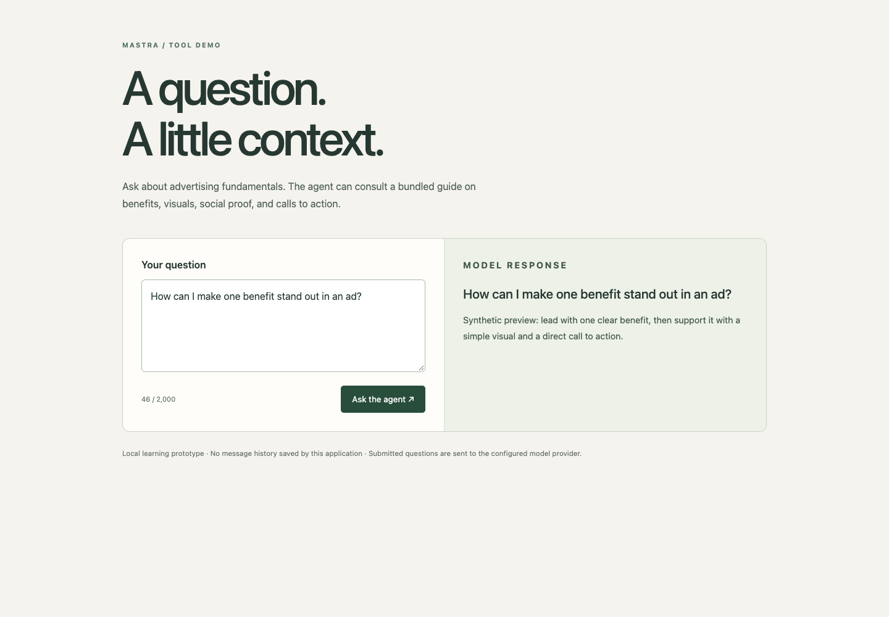
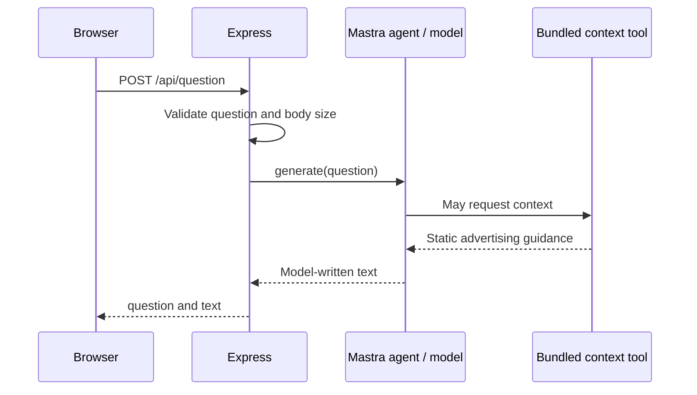

# Mastra context-agent demo

A Next.js interface and Express API showing how a Mastra agent can consult a local tool before answering a question. The bundled context is a short advertising guide. It is static text, not a database, vector index, document upload, or retrieval pipeline.



The screenshot uses an intercepted synthetic response, not an actual model result. [Mobile preview](docs/agent-mobile.png) shows the initial state at 390px. The UI explains what the tool can supply, validates empty input, handles bad responses and errors, and sends one question at a time.

## Boundaries of this example

Despite the original package names, this repository does not expose an MCP server or implement an MCP transport. It is a direct Express-to-Mastra integration. There is no saved conversation history, authentication, citations, streaming, model evaluation, or guaranteed tool use. Agent instructions request a tool call, but instructions alone do not prove the model followed them.

The separate weather route is a **simulated tool demonstration**. Its agent is now wired to `weatherTool`, not the advertising guide. The tool returns a fixed example and the response includes `simulated: true`; it is not a current-weather lookup. The main UI is for context questions.



## Run locally

Use Node.js 22. Both folders have separate lock files; no root workspace install is defined.

```sh
cd Backend
npm ci --ignore-scripts
cp .env.example .env
# Set your own OPENAI_API_KEY in the private .env file.
npm start
```

The Node command loads `Backend/.env` if present. The backend binds to `127.0.0.1:3001`; `FRONTEND_ORIGIN` defaults to `http://localhost:3000`. It needs a provider key for deliberate generation requests. Do not put that key in a frontend environment variable. Starting the backend constructs the agent registry; HTTP generation routes are the actions that request model output.

In another terminal:

```sh
cd Frontend
npm ci --ignore-scripts
cp .env.example .env.local
npm run dev
```

Open `http://localhost:3000`. `NEXT_PUBLIC_API_BASE` defaults to `http://localhost:3001` and is public browser configuration. Questions are sent to the configured model provider; use synthetic prompts for demonstrations. The UI stops waiting after 45 seconds, but this does not guarantee cancellation of provider work or billing on the server.

## API examples

`GET /` returns liveness JSON, not model/provider readiness. `POST /api/question` accepts:

```json
{"question":"How should an ad focus on one clear benefit?"}
```

Success is `{ "question": "...", "text": "..." }`. Questions must contain 1–2,000 characters, bodies are limited to 16 KiB, and provider failures return a generic 502 message without logging prompts or raw provider errors. `GET /api/weather?city=London` accepts one bounded city value and returns `{ "city": "London", "text": "...", "simulated": true }`. The old placeholder login route was removed; there is no login system.

## Checks

```sh
cd Backend
npm test
npm run typecheck
cd ../Frontend
npm run build
npm run lint
```

Three offline Node test groups pass against an injected agent registry: input limits before generation, trimmed context responses, repeated-city rejection, simulated weather marking, generic failures, and oversized bodies. Backend type checking passes. The Next.js production build includes successful frontend lint/type checking. Chrome checked synthetic success, provider failure, invalid/empty response handling, disabled empty submission, no model request on initial render, and desktop/mobile layouts. Both locked installs ran with scripts disabled.

No live model, weather service, Mastra development server, or provider account was called. Real tool invocation and answer grounding remain unverified. There is no backend rate limit, provider deadline, concurrency limit, or authenticated cost boundary; keep this local before adding a hosting plan. A useful next step is a small fixture-based tool-use evaluation with explicit expected/unsupported questions, rather than claims of autonomous reasoning.
