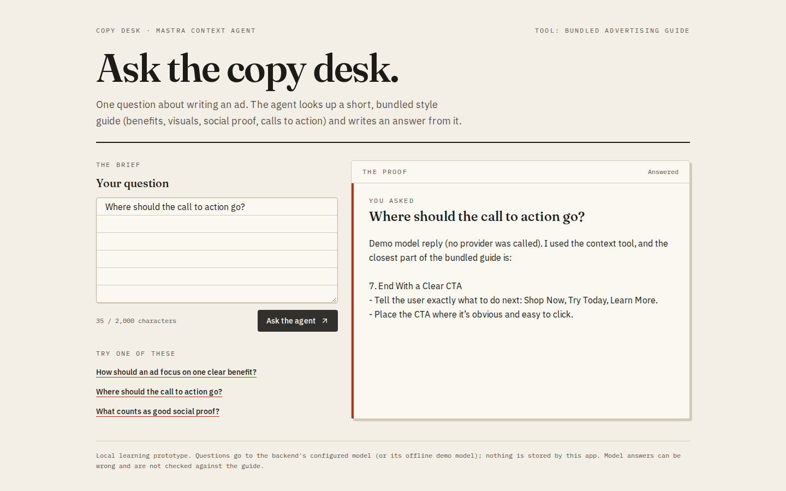
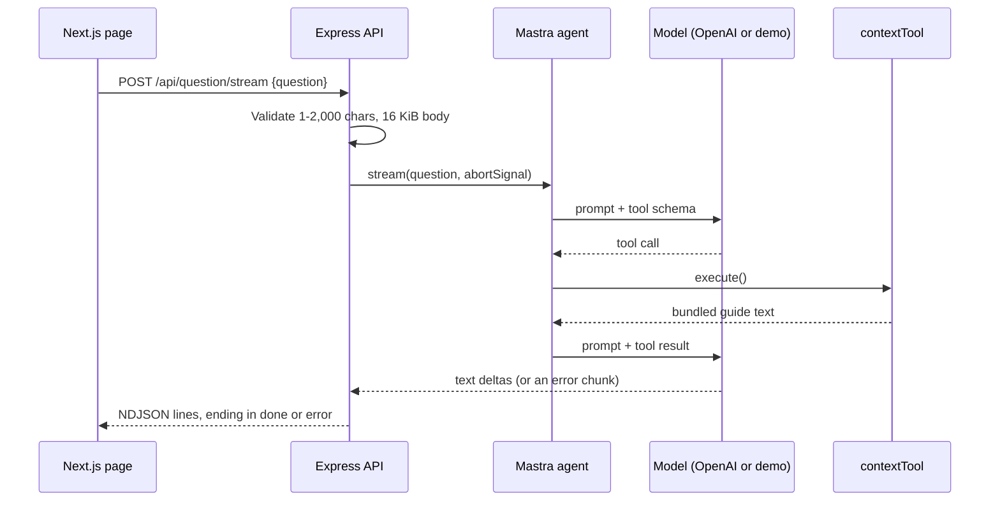

# Mastra context-agent demo

A small Next.js "copy desk" in front of an Express API that hosts two [Mastra](https://mastra.ai) agents. You ask one question about writing an ad. The context agent is told to call a local tool that returns a short, bundled advertising guide, and its answer streams back into the page as it is written.

The guide is seven static bullet lists. There is no database, vector index, upload or retrieval pipeline. The point of the repository is the plumbing around an agent call: input limits, a server-side deadline, streaming with honest failure reporting, and a test suite that never needs a provider key.



All screenshots use the offline demo model described below, not a real model result. More: [a mid-stream provider failure](docs/screenshots/agent-error-desktop.png) and [the empty state at 390 px](docs/screenshots/agent-empty-mobile.png).

## What it does and does not do

- **Context agent** (`POST /api/question`, `POST /api/question/stream`). Its instructions ask it to call `contextTool` and answer from the guide. Instructions do not guarantee that a real model follows them, and answers are not checked against the guide.
- **Weather agent** (`GET /api/weather`). This is a simulated tool demonstration. `weatherTool` returns a fixed "sunny" line for the requested city, and the response carries `simulated: true`. It is not a weather lookup, and the UI does not use it.
- **Two model modes.** `MODEL_PROVIDER=openai` uses `gpt-4o-mini` with your own key. `MODEL_PROVIDER=demo` uses an offline stand-in built on the AI SDK's `MockLanguageModelV4`. The stand-in really drives the Mastra agent loop (tool call, tool result, final text), but its words are canned: it quotes the guide section that shares the most words with your question.
- Not included: an MCP server or transport, conversation memory, authentication, rate limiting, citations or evaluation. The original package names mentioned MCP; nothing here implements it.



## Quick start with Docker Compose

```sh
docker compose up --build
```

Open http://localhost:3000. With no key in your shell, the backend starts the offline demo model and logs `with the offline demo model (no provider calls)`. To use a real model:

```sh
MODEL_PROVIDER=openai OPENAI_API_KEY=<your key> docker compose up --build
```

Both images run as the unprivileged `node` user, and both ports are bound to 127.0.0.1. If 3000 or 3001 is taken, set `FRONTEND_PORT` and/or `BACKEND_PORT`; the CORS origin and the API address built into the UI follow them.

## Running without Docker

Use Node.js 22.18 or later (see `.nvmrc`). The backend runs its TypeScript sources directly through Node's built-in type stripping, so there is no build step. The two folders have separate lock files.

```sh
cd Backend
npm ci --ignore-scripts
cp .env.example .env
# In Backend/.env set MODEL_PROVIDER=demo, or keep openai and fill in OPENAI_API_KEY.
npm start
```

In a second terminal:

```sh
cd Frontend
npm ci --ignore-scripts
cp .env.example .env.local
npm run dev
```

Open http://localhost:3000. Keep the provider key in `Backend/.env` only; `NEXT_PUBLIC_API_BASE` is public browser configuration.

### Backend settings

| Variable | Default | Notes |
|---|---|---|
| `MODEL_PROVIDER` | `openai` | `openai` or `demo`. |
| `OPENAI_API_KEY` | none | Required only for `openai`. If it is missing, startup prints one `Configuration error:` line and exits 1. |
| `HOST` / `PORT` | `127.0.0.1` / `3001` | The Docker image sets `HOST=0.0.0.0`. |
| `FRONTEND_ORIGIN` | `http://localhost:3000` | The CORS allow-list. A trailing slash is normalised away. |
| `MODEL_TIMEOUT_MS` | `40000` | Server deadline per model call (1,000 to 120,000). It sits under the page's 45 s timeout, so the server reports the timeout first. |

## API

The responses below were captured from the Compose stack running the demo model.

```sh
curl -s -X POST localhost:3001/api/question -H 'Content-Type: application/json' \
  -d '{"question":"What counts as good social proof?"}'
```

```json
{"question":"What counts as good social proof?","text":"Demo model reply (no provider was called). I used the context tool, and the closest part of the bundled guide is:\n\n5. Build Social Proof\n- Feature a short customer quote, rating, or proof point (e.g., “10,000+ happy customers”).\n- This builds instant credibility."}
```

`POST /api/question/stream` takes the same body and answers `application/x-ndjson`, one event per line:

```text
{"type":"text","delta":"Demo "}
{"type":"text","delta":"model "}
{"type":"text","delta":"reply "}
...
{"type":"done"}
```

The final line is always either `{"type":"done"}` or a single `{"type":"error","message":"..."}`, even if text has already been sent. The page keeps the partial text and marks it "Answer interrupted".

```sh
curl -s 'localhost:3001/api/weather?city=Porto'
```

```json
{"city":"Porto","text":"Demo model reply. The weather tool says: Simulated example for Porto: sunny. No current weather provider was queried.","simulated":true}
```

Errors are JSON `{"error": "..."}`:

| Status | When |
|---|---|
| 400 | Empty or over-long question, repeated `city`, malformed JSON |
| 413 / 415 | Body over 16 KiB / unsupported charset |
| 502 | Provider failure or an empty answer. Raw provider messages are not returned. |
| 504 | The model missed `MODEL_TIMEOUT_MS` |

`GET /` is a liveness check only; it does not test the provider.

## Design notes

- **Deadlines that actually fire.** Under Mastra 1.x an aborted `generate()` resolves with empty text and `finishReason: "aborted"` instead of throwing. Without an explicit check, a stalled provider would come back as a blank 200. Each call gets `AbortSignal.any([deadline, client-disconnect])`, so a closed tab also stops provider work.
- **Stream errors are in-band.** Mastra reports provider failures as `error` chunks inside `fullStream`, not as exceptions. The API turns them into the terminal NDJSON error event. On the client, `readAnswerStream` treats a stream that ends without `done` as unfinished, not complete.
- **Tool input is validated.** The weather tool's `location` is trimmed and limited to 1-120 characters. Invalid calls come back to the model as a structured tool error instead of running.
- **Testable without a key.** Agents are built by `createMastra(model)`, so tests pass in `MockLanguageModelV4` and exercise the real Mastra loop.
- `@ai-sdk/openai` is pinned to 4.0.106 and `ai` to 7.0.160. These match the provider build bundled inside `@mastra/core` 1.82; newer patches fail type checking against Mastra's model type.

## Tests and checks

```sh
cd Backend && npm test && npm run typecheck
cd ../Frontend && npm test && npm run lint && npm run build
```

- **Backend:** 25 `node:test` cases. They cover HTTP validation and limits, timeouts (both resolving-aborted and rejecting providers), client-disconnect aborts, NDJSON streaming and its error paths (one through a real Mastra agent with a failing mock model), startup configuration, tool input validation, and the demo model.
- **Frontend:** 5 cases for the stream reader (split lines, error events, truncated streams, unreadable lines, HTTP error messages).

No test, screenshot or example in this repository called a live model or weather service. Screenshots were taken with Playwright in Chromium against the demo model; the error screenshot injects a failing stream at the network layer.

Not covered: real tool-use reliability with `gpt-4o-mini`, answer quality, and any cost boundary. There is no rate limit or authentication, so keep this on localhost.

## License

MIT, see [LICENSE](LICENSE).
